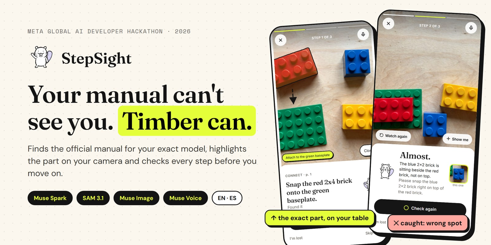
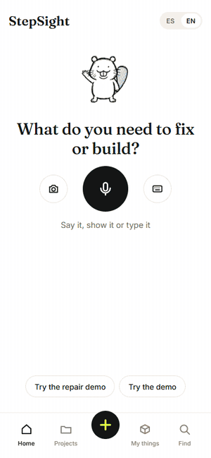
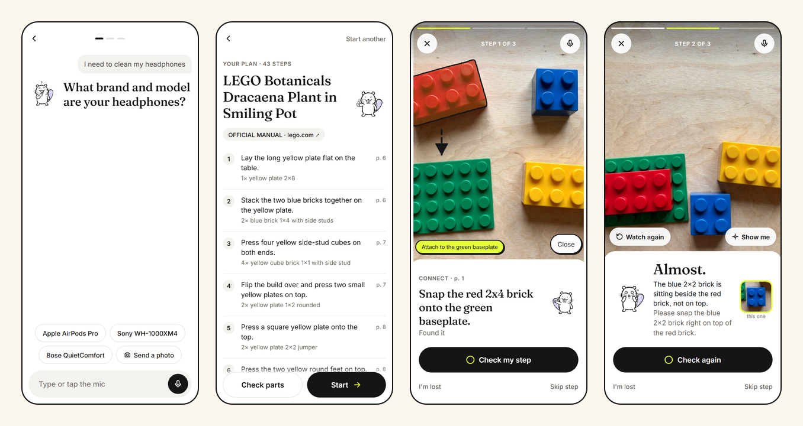
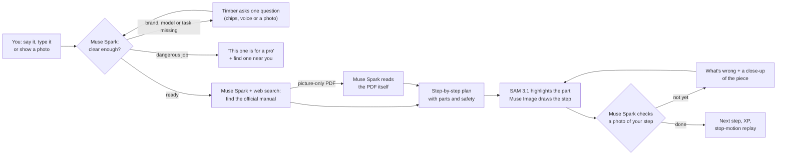
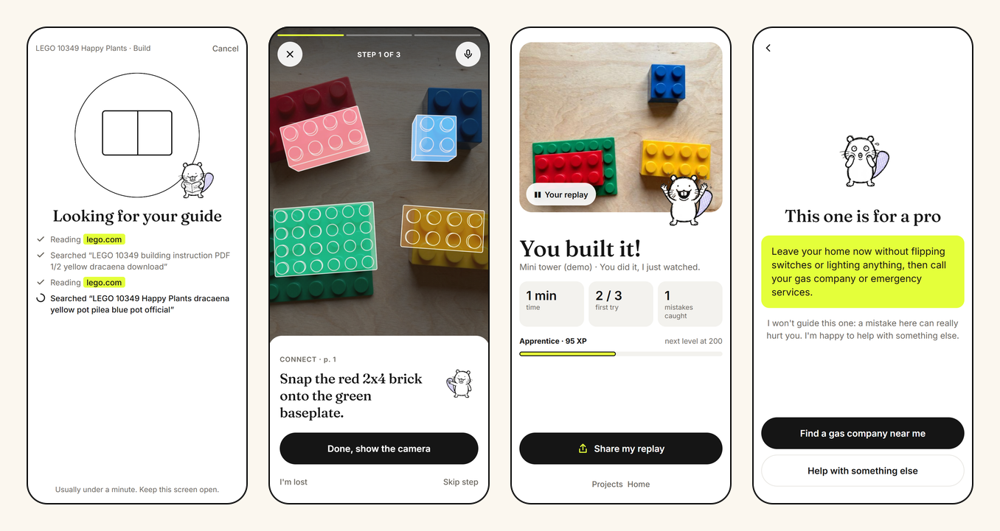

<p align="center">
  
</p>

<p align="center">
  <a href="https://stepsight.vercel.app"><b>▶ Try it live</b></a> ·
  <a href="#demo-video">Demo video</a> ·
  <a href="#how-timber-works">How it works</a> ·
  <a href="#tested-not-guessed">Test results</a> ·
  <a href="#run-it-yourself">Run it</a>
</p>

<p align="center">
  
  
  
  
  
</p>

<h3 align="center">A chatbot tells you how. StepSight watches you do it.</h3>

<table align="center">
  <tr>
    <td align="center"><b>4</b><br>Meta models working together</td>
    <td align="center"><b>57 / 57</b><br>conversations understood</td>
    <td align="center"><b>96 / 96</b><br>step checks and voice commands</td>
    <td align="center"><b>4 / 4</b><br>dangerous jobs sent to a pro</td>
  </tr>
</table>

<table>
  <tr>
    <td width="320" valign="top"></td>
    <td valign="top">

### What you're watching

1. **You ask, Timber finds the manual.** Say, type or show what you need; Timber asks for the exact model, then finds the official manual on the web.
2. **The exact part lights up.** SAM 3.1 cuts the red brick out of your own camera and flies it to where it goes: *"grab this one!"*, *"CLICK!"*
3. **Every step is checked.** Muse Spark looks at a photo of your step. The blue brick beside the red one? *"Almost."*, with what to fix and a close-up of the piece.
4. **You built it.** A stop-motion replay of your build, ready to share as a GIF.

No camera or bricks needed: open [stepsight.vercel.app](https://stepsight.vercel.app) and tap **Try the demo**.

  </td>
  </tr>
</table>

## The problem

Manuals are dense, generic and often in the wrong language. People stare at page 14, guess, get a step wrong and only find out three steps later, or give up and throw the thing away. Asking a chatbot doesn't help much: it tells you how to do it, but it can't see what you did.

**StepSight watches you do it.** You say what you need, it finds the manual for your exact model, points at the part on your own table and checks your work after every step.

## What makes it different

<p align="center">
  
</p>

| | A chatbot | StepSight |
| --- | --- | --- |
| Which instructions? | Generic advice | Asks for brand and model, then finds the official manual (it even reads LEGO's picture-only PDFs). Not online? Photograph the paper booklet and Timber reads the pages |
| Which part? | "The small blue piece" | SAM 3.1 outlines the exact part on your camera |
| Did I do it right? | You'll find out later | Muse Spark checks a photo of every step and says what it sees; a wrong piece is caught on the spot |
| Is it safe? | Answers anything | Gas, mains electricity, car brakes: Timber says who to call instead. Electric jobs start with a camera-checked "it's unplugged" step that can't be skipped |
| Where's this from? | Unclear | Every guide is tagged "Official manual" or "Web guide" with its link |
| My language? | Maybe | The whole app, the steps, the checks and Timber's voice switch to Spanish |

## Demo video

<!-- Add the 3-minute demo video link here before submitting. -->
3-minute walkthrough: building a LEGO set with a deliberate mistake caught, a lamp repair with its safety gate, and a request Timber refuses to guide.

**No camera or bricks?** On [stepsight.vercel.app](https://stepsight.vercel.app), tap **Try the demo** (a 3-step brick tower with a deliberate mistake on step 2) or **Try the repair demo** (change a lamp bulb, unplug step first).

## How Timber works

Timber is an agent: it decides what it still needs to know, goes and gets it, and checks the real world before it moves on.



What Timber decides on its own:

- **Asks before it searches.** "Clean my headphones" isn't enough: cleaning a Sony WH-1000XM4 is nothing like cleaning AirPods, so it asks for the model (or a photo of the label) first.
- **Refuses what a beginner shouldn't do.** Gas leaks, breaker panels, car brakes and the inside of a microwave get a "this one is for a pro" screen with a button to find one nearby.
- **Doesn't trust a guess.** A blurry photo is "not done, show me another angle", never a pass. If it can't clearly see a part, it says so instead of highlighting the wrong thing.
- **Checks its own drawings.** Every step drawing from Muse Image is reviewed by Muse Spark before you see it; a wrong one is redrawn or dropped.

## Meta AI, used for what each model is best at

| Model | What it does in StepSight | Where |
| --- | --- | --- |
| **Muse Spark 1.3** | Understands the request and runs the follow-up chat; searches the web for the official manual and reads picture-only PDFs; checks each step from a photo; understands what you say mid-build; identifies products for "My things"; spots dangerous jobs; reviews every step drawing | [`lib/spark.ts`](lib/spark.ts), [`lib/manual.ts`](lib/manual.ts) |
| **SAM 3.1** | Outlines the exact part on the camera and its destination; checks that every part is on the table | [`lib/sam.ts`](lib/sam.ts), [`components/CameraStage.tsx`](components/CameraStage.tsx) |
| **Muse Image 1.0** | Draws each step as a 3-panel strip; the demo's strips are drawn from its real photos so every brick matches; made Timber's nine poses and the demo photos | [`app/api/animate`](app/api/animate/route.ts), [`scripts/make-strips.mjs`](scripts/make-strips.mjs) |
| **Muse Voice Transcribe 1.0** | Hands-free: say what you need, answer Timber's questions, ask "where's the red brick?" mid-build | [`lib/voice.ts`](lib/voice.ts), [`scripts/voice-relay.mjs`](scripts/voice-relay.mjs) |

Timber's spoken voice comes from Fish Audio, with a native voice per language.

<p align="center">
  
</p>

## Tested, not guessed

The AI is checked by repeatable labs that run real conversations and real photos against the app, several times each, so a lucky answer doesn't count.

| Lab | What it throws at Timber | Result |
| --- | --- | --- |
| [Understanding](scripts/lab/run.mjs) | 57 conversations: LEGO sets, repairs, cleaning, setup, product photos, typos, Spanglish, emoji, rambling stories, made-up brands, changed minds, off-topic asks and dangerous jobs (latest full run) | 57 / 57 |
| [Building](scripts/lab/build.mjs) | 16 step checks on real photos (each "done" paired with a near miss, like the blue brick beside the red one) and 16 things people say mid-build, in English and Spanish, 3 runs each | 96 / 96 |
| [Voice](scripts/smoke/voice-lab.mjs) | Timber's lines spoken and transcribed back to catch wrong-language takes | 0 bad takes |

Bugs these labs caught and fixed: asking for the brand before searching, LEGO cleaning treated as building, recipes accepted as tasks, a filler "uhh" read as "next", and Timber inventing how many steps were left.

## Run it yourself

Needs Node 22, a Meta Model API key and a Fish Audio key.

```bash
cp .env.example .env   # add MODEL_API_KEY and FISH_AUDIO_API_KEY
npm install
npm run dev            # http://localhost:3000
```

On a phone on the same Wi-Fi: `npm run dev:phone`, then open `https://<your-computer-ip>:3000` and accept the certificate warning (browsers only allow the camera over HTTPS).

Run the labs against a running app:

```bash
node scripts/lab/run.mjs --runs=3     # understanding
node scripts/lab/build.mjs --runs=3   # step checks and voice commands
```

## Built during the hackathon

Everything here was built for the Meta Global AI Developer Hackathon, Oct 26 – Nov 4, 2026 (Indie track, *Build for Your World*). The commit history shows the work day by day.

<details>
<summary><b>Screen by screen</b></summary>

1. **Home** (`/`): one question, "What do you need to fix or build?" Say it with the mic, type it or snap a photo; a voice request goes straight to Timber. Two demos sit underneath, plus your current project.
2. **New project** (`/manual`): Muse Spark works out the product, whether you're building or fixing it, and what's wrong. When something is missing, Timber asks up to four short questions with quick-answer chips, typing, the mic or a photo. Then it searches the web for the manual (the screen shows each search and page it opens) or reads a pasted PDF link. The plan shows the source tag and every step.
3. **Check parts** (`/parts`): one photo of all the parts; SAM looks for every color the manual needs.
4. **Build** (`/build`): fixes start with a tools and safety checklist. Each step is **do** (just tap Done), **find** (Timber points the part out) or **verify** (a photo check). **Show me** highlights the part with SAM, with a dashed arrow to where it goes. A correct step flashes "Solid!" and moves on; a wrong one shows "Almost." with what to fix and a close-up of the piece. **I'm lost** offers a replay, a simpler explanation, the manual page or a question for Timber, plus sound, captions, vibration, slower animations and bigger text.
5. **Talk to Timber** mid-build: "where's the gray clip?", "ok what now?", "say that again".
6. **You built it** (`/done`): a stop-motion replay of every step, your stats and a share card (GIF).
7. **Projects** and **My things** (products you own, identified from a photo, so asking for help later skips the questions).

</details>

<details>
<summary><b>Live voice relay</b></summary>

`npm run voice` starts a small relay on port 3001 that streams your mic to Muse Voice Transcribe realtime and keeps the API key off the browser. With `NEXT_PUBLIC_VOICE_URL=auto` the app finds it on the same host. Without the relay the mic falls back to record-then-transcribe. Vercel can't hold WebSockets, so in production run the relay on any Node host (Render, Fly, Railway), set `VOICE_ORIGINS` to your app's URL and `NEXT_PUBLIC_VOICE_URL` to the relay's `wss://` address.

</details>

<details>
<summary><b>All scripts and smoke tests</b></summary>

Quick checks that each model works with our inputs. Copy `.env.example` to `.env`, put test files in `samples/` (ignored by git) and run:

| Command | Model | What it checks |
| --- | --- | --- |
| `npm run smoke:spark` | Muse Spark 1.3 | Key and connection |
| `npm run smoke:manual -- samples/manual.pdf` | Muse Wonder | PDF manual → build steps JSON |
| `npm run smoke:sam -- samples/parts.jpg "red 2x4 brick"` | SAM 3.1 | Finds the part; overlay in `smoke-output/sam-overlay.svg` |
| `npm run smoke:compare -- samples/step.png samples/build.jpg` | Muse Spark 1.3 | Build photo vs manual step |
| `npm run smoke:voice -- samples/command.wav` | Muse Voice Transcribe | Voice command to text |
| `node scripts/smoke/verify-eval.mjs <folder> [url]` | Muse Spark 1.3 | Step-check accuracy on your own good/bad photos (`step.json`, `good/`, `bad/`) |
| `node scripts/lab/run.mjs [--runs=3] [--cat=lego] [--manual]` | Muse Spark 1.3 | Understanding lab, report in `smoke-output/lab-report.md`; test photos from `scripts/lab/photos.mjs` |
| `node scripts/lab/build.mjs [--runs=3]` | Muse Spark 1.3 | Step checks on the demo photos and mid-build voice commands |
| `node --env-file=.env scripts/smoke/voice-lab.mjs` | Fish Audio + Muse Voice | Speaks Timber's lines with each voice and transcribes them back |
| `node --env-file=.env scripts/make-strips.mjs` | Muse Image | Redraws the tower demo's step strips from its real photos |
| `node scripts/make-anims.mjs` | Muse Image | Redraws the lamp demo's step strips (dev server running) |
| `npm run smoke:image` | Muse Image | Timber master sheet |
| `npm run smoke:speak -- "Solid. Next one."` | Fish Audio | Timber's voice |
| `npm test` | — | WAV encoder and rate limiter |

</details>

<details>
<summary><b>What we learned about the models</b></summary>

- SAM 3.1 finds "blue brick" but not "blue 2x2 brick", so the app retries without sizes before asking Muse Spark to locate the part.
- SAM 3.1 matches by color and type, not size: "white 2x2 brick" also returns white 2x4 bricks.
- Muse Spark's web search can't see picture-only manuals (LEGO), but it finds the official PDF and reads it directly when given the file.
- An English voice reading Spanish came out with a foreign accent; one voice that speaks both languages, told which one to use, fixed it.
- Only the first 50 pages of a PDF are read as images; Muse Spark turned a LEGO booklet into 43 steps with parts in about a minute.
- Voice input needs WAV, mono, 16-bit PCM at 16 or 24 kHz.

</details>

## License

[MIT](LICENSE)
